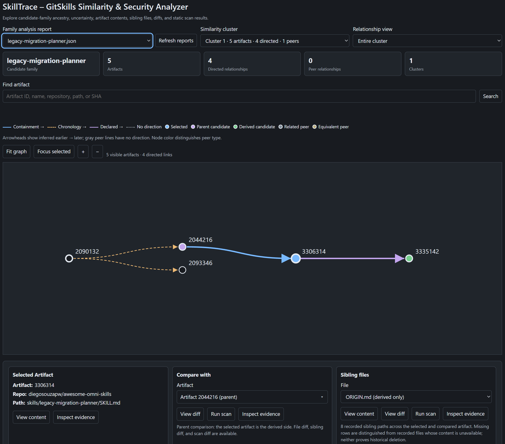
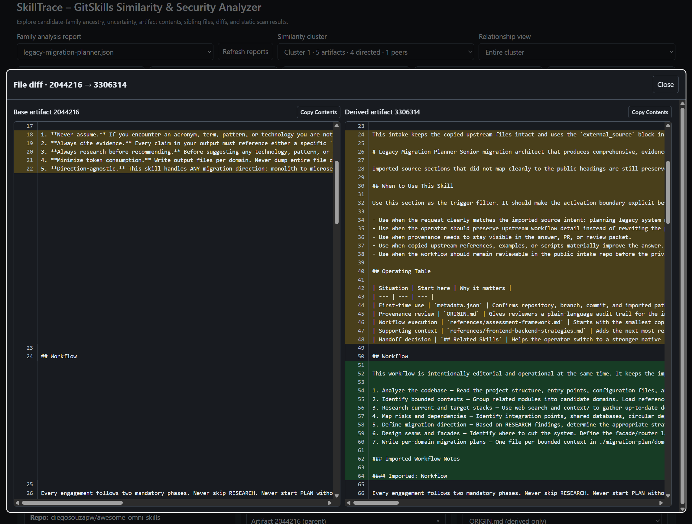
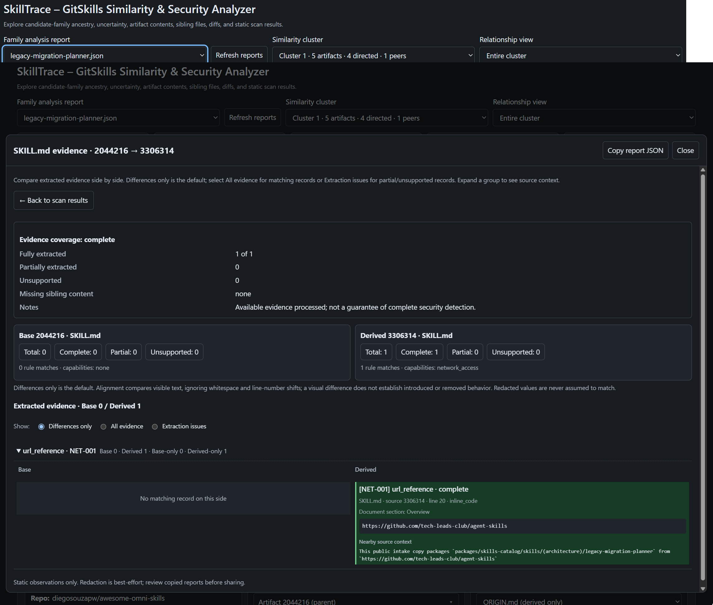

# CSC 580 Group Project - Mining AI-Native Software Engineering

This group project investigates AI-native software engineering using research directions inspired by the [MSR 2027 Mining Challenge](https://2027.msrconf.org/track/msr-2027-mining-challenge). Our team focuses on **skill security and supply-chain risk** in the GitSkills dataset: whether modified or reused skills introduce security-sensitive behavior not present in related artifacts. We use a reproducible pipeline to analyze artifact relationships, detect changes with static security rules, and validate findings through manual review. The project is developed iteratively using Scrum, with tested code, documented methods, reproducible results, and analysis of limitations.

More information is available in our [Research Question](RESEARCH_QUESTION.md) and [Threat Model](THREAT_MODEL.md).

## Team and Roles

- Kyle Cantrell (Scrum Master)
- Christian Heiney (Researcher/Developer)
- Vaisnavii Mohanraj (Researcher/Developer)
- Jim Prantzalos (Product Owner)

## Getting Started

The steps below set up the project source code, Python environment, dependencies, and local DuckDB database. You will need Git, Python 3.12 or newer (below 4.0), `uv`, and the [DuckDB CLI](https://duckdb.org/docs/installation/). The checked Windows configuration uses Python 3.12.3 and DuckDB CLI 1.5.6. Allow space for the 44.4 GB SQLite download, approximately 40 GB of prepared DuckDB data, and additional import temporary files and scan outputs. Internet access is required for dependencies, the dataset, and DuckDB's SQLite extension. See the [data setup guide](data/README.md).

### 1. Clone the repository

Clone the project and change into the repository directory:

```bash
git clone https://github.com/umdnp/csc580-project8.git
cd csc580-project8
```

### 2. Install `uv`

We recommend [`uv`](https://docs.astral.sh/uv/) for managing Python environments and dependencies. If needed, follow the [official installation instructions](https://docs.astral.sh/uv/getting-started/installation/).

### 3. Create the Python virtual environment

From the repository root:

```bash
uv venv
```

### 4. Install project dependencies

Dependencies are defined in `pyproject.toml`. Install them with:

```bash
uv sync --locked
```

#### Windows repositories inside OneDrive

Keep the virtual environment outside OneDrive to avoid sync conflicts with
lock files and installed packages. Instead of step 3, run these commands in
PowerShell from the repository root:

```powershell
$env:UV_PROJECT_ENVIRONMENT = "$env:LOCALAPPDATA\uv\environments\csc580-project8"
$env:UV_LINK_MODE = "copy"
uv sync --locked
```

Set these variables in each new terminal before using `uv sync` or `uv run`.
For VS Code, they can be persisted in local workspace settings under
`terminal.integrated.env.windows`; reopen the terminal after changing settings.
Select the external environment's `Scripts\python.exe` as the Python interpreter
and notebook kernel. Deactivate an old `.venv` before using the new environment.
Do not use `uv sync --active`, which targets the active environment instead.

An existing `.venv` with missing `RECORD` files is still damaged; renaming its
`.lock` file does not repair it, and `uv` may recreate that file. The external
environment does not require deleting the old one.

### 5. Download the GitSkills dataset

Use **GitSkills version 1.0.0, Zenodo record 21875637**, not a moving "latest" release. The original file is **SQLite**, not DuckDB. In PowerShell:

```powershell
New-Item -ItemType Directory -Force C:\data\sqlite, C:\data\duckdb
curl.exe --fail --location --output C:\data\sqlite\agent_skills_release.db "https://zenodo.org/records/21875637/files/agent_skills_release.db?download=1"
if ($LASTEXITCODE -ne 0) { throw "Dataset download failed" }
$checksum = (Get-FileHash C:\data\sqlite\agent_skills_release.db -Algorithm MD5).Hash
if ($checksum -ne "B058631FB1926EFAC6E82A4706646742") { throw "Dataset checksum mismatch" }
```

The published file is 44,388,249,600 bytes. MD5 here checks agreement with Zenodo's published file checksum; it is not a security guarantee. No GitHub credentials are required. Do not commit the database or extracted source content.

### 6. Build the local DuckDB database

From the repository root, the native Windows DuckDB CLI accepts these PowerShell commands. Start with a **new output file**; do not overwrite an existing research database:

```powershell
if (Test-Path C:\data\duckdb\agent_skills_release.db) { throw "Choose a new DuckDB output path before importing" }
$env:GITSKILLS_SQLITE_DB = "C:\data\sqlite\agent_skills_release.db"
duckdb -no-init -bail C:\data\duckdb\agent_skills_release.db -f sql\create_gitskills_duckdb.sql
if ($LASTEXITCODE -ne 0) { throw "SQLite import failed; do not continue with the incomplete output" }
duckdb -no-init -bail C:\data\duckdb\agent_skills_release.db -f sql\create_analysis_tables.sql
if ($LASTEXITCODE -ne 0) { throw "Analysis table creation failed" }
duckdb -no-init -bail C:\data\duckdb\agent_skills_release.db -f sql\update_artifact_groupings.sql
if ($LASTEXITCODE -ne 0) { throw "Artifact grouping update failed" }
```

The import prints source/imported row counts and unresolved foreign-key counts. Require matching counts and zero unresolved IDs. The grouping SQL retains valid frontmatter, bodies longer than 50 characters, non-NULL content/name/description, and exact names occurring at least twice. The update computes available file-sibling fingerprints. Keep both SQL steps in this order.

Alternatively, in **Git Bash with the native Windows DuckDB CLI**, run:

```bash
bash bin/create_gitskills_db.sh
```

Then create the analysis tables and artifact groupings:

```bash
duckdb /c/data/duckdb/agent_skills_release.db < sql/create_analysis_tables.sql
duckdb /c/data/duckdb/agent_skills_release.db < sql/update_artifact_groupings.sql
```

The shell script hardcodes `/c/data/...` locations and requires a Git checkout. For Linux/WSL, change its configuration to real Linux paths before running it; `/c/...` is not a standard WSL mount. See the [local database setup instructions](data/README.md#local-duckdb-development-setup) and [Data Dictionary](DATA_DICTIONARY.md). The Sprint 1 sample-view SQL is not required for the 30-family baseline.

### 7. Configure the database path

Set `GITSKILLS_DB` to the generated **DuckDB** file in each terminal before launching the pipeline, notebook, or SkillTrace. In PowerShell:

```powershell
$env:GITSKILLS_DB = "C:\data\duckdb\agent_skills_release.db"
uv run --locked python -c "import os, duckdb; c = duckdb.connect(os.environ['GITSKILLS_DB'], read_only=True); print(c.execute('SHOW TABLES').fetchall()); c.close()"
```

Require `artifacts`, `artifact_groupings`, `artifact_siblings`, and `repos`. Use `uv run --locked`, not an unrelated global `python` installation. Close database-writing sessions before analysis. For Git Bash with Windows Python:

```bash
export GITSKILLS_DB="C:/data/duckdb/agent_skills_release.db"
```

Use `/mnt/c/data/duckdb/agent_skills_release.db` with Linux Python in WSL, or follow the [Project Guide](docs/instructions/getting_started.md) for other environments.

## End-to-End Research Pipeline

### Reproduce the reported baseline, not a new random sample

The report describes the provisional **30-family Sprint 2 cohort**, whose exact names are committed in [families.txt](notebooks/end_to_end_pipeline/sprint2/samples/families.txt). Its [manifest](notebooks/end_to_end_pipeline/sprint2/results/sample_manifest.json) records code revision `e1d6b773956c87877c51c8b0faa9ebb39fffdaf3`, **all** directed edges, shingle size 5, containment 0.8, Jaccard 0.3, five shared shingles, direction margin 0.1, and manual-review seed 580 with up to five pairs per stratum. Selection was purposive, not random. Approval and independent adjudication remain pending.

**Do not assume the current notebook defaults reproduce the report.** It defaults to Sprint 3 and primary edges. Current scanner fixes also change indicator counts, even with the original families and all edges. See the [reproduction check and historical commands](docs/instructions/reproducibility.md) before comparing results with report claims.

To run the same cohort under the **current code** from the repository root, use this PowerShell command with a new output directory:

```powershell
uv run --locked python -m gitskills.tools.summarize_cohort `
  --input notebooks\end_to_end_pipeline\sprint2\samples\families.txt `
  --output output\baseline-current `
  --edges all --rescan --per-stratum 5 --seed 580 `
  --shingle-size 5 --min-containment 0.8 --min-jaccard 0.3 `
  --min-shared-shingles 5 --direction-margin 0.1
```

`GITSKILLS_DB` supplies the database; `--db` can specify it explicitly. This command performs relationship analysis, security comparisons, review sampling, tables, and the indicator-frequency SVG without requiring prior family reports or scan caches. At revision `0baeb0fff3e3e8598c5754cdf5637a0799142d8e`, the isolated check produced **3,997 comparisons and 577 indicator-bearing pairs**, not the report's older 588. Do not replace committed results or report claims without reconciling code and input provenance.

### Notebook execution and the remaining figures

The [`end_to_end_pipeline.ipynb` notebook](notebooks/end_to_end_pipeline/end_to_end_pipeline.ipynb) runs the same pipeline and renders three additional figures. Open it using the project interpreter, or launch JupyterLab:

```bash
uv run --locked --with jupyterlab jupyter lab
```

For a new current-code baseline run, set `SPRINT = 2`, `EDGES = "all"`, `PER_STRATUM = 5`, `SEED = 580`, and `POLICY = SimilarityPolicy()`. After **Set Variables**, override `RESULT_DIR = PROJECT_ROOT / "output" / "baseline-current"` and `SCAN_CACHE_DIR = RESULT_DIR / ".scans"` before running the analysis. This avoids overwriting committed Sprint 2 results. Run through **Findings for manual review**. The final adjudication cell is only for completed independent reviews.

If the CLI run already exists, run the imports and variable/configuration cells with those overrides, then the results/plot cells, skipping the `summarize_cohort()` execution cell. To plot historical outputs, point `RESULT_DIR` to the historical output directory and likewise skip current-code analysis.

Each output directory contains `sample_manifest.json`, `execution_summary.json`, `audit/`, `review/` (summary plus six CSV tables), `manual-review/`, and `figures/`. The notebook adds `pair_outcomes.svg`, `indicators_by_family.svg`, and `indicators_by_edge_type.svg` alongside `indicator_frequency.svg`. Inspect numerical CSV/JSON values, not just graph appearance. See the [Pipeline README](notebooks/end_to_end_pipeline/README.md) and [saved baseline guide](notebooks/end_to_end_pipeline/sprint2/README.md).

### Optional experiments

Sprint 3 random 100-family samples (`family_picker`, seeds 5801/5802/5803), primary-only comparisons, and timing benchmarks are **not necessary to reproduce the reported 30-family all-edge baseline**. Their configuration and status must be recorded separately; do not treat local uncommitted trial outputs as published baseline results. See [TOOLS.md](TOOLS.md).

## Build the Research Report

The report builds from committed Markdown, bibliography, appendices, diagram sources, and toolchain metadata; it does not require rerunning the dataset analysis. From the repository root on Windows x64:

```powershell
uv run --locked python bin\setup_report_tools.py
uv run --locked python bin\build_report.py --format html
uv run --locked python bin\build_report.py --format docx
uv run --locked python bin\build_report.py --format pdf
```

The first command downloads checksum-pinned Pandoc, Java, and PlantUML. The PDF command additionally requires XeLaTeX (MiKTeX or TeX Live) and its LaTeX packages. HTML and Word go to `report/generated-report/`; PDF goes to `report/final.pdf`, replacing that file. Build in an isolated checkout if preserving the committed PDF. See the [report build guide](report/README.md) for installation, offline cached diagrams, and non-Windows setup.

## Automated Tests

From the repository root:

```bash
uv run --locked python -m pytest
```

Tests use constructed inputs and temporary databases; the full GitSkills dataset is not required. See the [testing guide](tests/sample_skills/README.md#testing).

## Limitations

Inferred relationships do not establish historical copying or ancestry, and scanner detections are not proof of malicious behavior. Incomplete data and static-analysis limitations can affect findings. See [Threats to Validity](THREATS_TO_VALIDITY.md) and the [design documentation](docs/design/ARCHITECTURE.md). Dataset content is inspected, **not executed**.

The [reproduction check](docs/instructions/reproducibility.md) distinguishes verified installation, numerical reruns, and report builds from remaining gaps. A complete reimport of the 44.4 GB source database was not performed in that check; a checksum-verified external source, a pre-existing prepared database, and a fresh SQLite preparation fixture were used instead. The repository does not bundle the historical prepared snapshot. Surrogate/group IDs, absolute paths, Python versions, SVG metadata, timing, and PDF pagination may differ across environments. A fixed seed does not compensate for changed code, inputs, or edge policy.

## SkillTrace - Visual Inspection and Manual Validation

**SkillTrace** is a browser-based tool we built to support manual inspection of GitSkills artifacts. It visualizes artifact relationships, compares differences between skill files (`SKILL.md`) and sibling resources, and runs scans to display detected changes and supporting evidence alongside visual diffs. We use it to manually validate the pipeline's findings.

<table>
  <tr>
    <td width="33%" align="center">
      <a href="figures/skilltrace/skilltrace_home.png">
        
      </a>
    </td>
    <td width="33%" align="center">
      <a href="figures/skilltrace/skilltrace_diff.png">
        
      </a>
    </td>
    <td width="33%" align="center">
      <a href="figures/skilltrace/skilltrace_scan.png">
        
      </a>
    </td>
  </tr>
</table>

To inspect a family, first generate its report from the repository root:

```bash
uv run python -m gitskills.tools.analyze_family cometchat-core --output apps/skilltrace/reports
```

Then start SkillTrace:

```bash
uv run python -m apps.skilltrace --host 127.0.0.1 --port 8000
```

Open **http://127.0.0.1:8000**, select a family report, and choose artifacts to inspect. Use the diff views and **Run scan** / **Inspect evidence** tools to compare detections against the original content. SkillTrace's on-demand scans inspect a selected skill or sibling file; the notebook performs the broader family-level analysis.

For manual validation, we use the notebook's directed-pair and relationship-pair samples to check inferred relationships and scanner accuracy. Working review records are stored in the [directed-pair annotations](notebooks/end_to_end_pipeline/sprint2/results/manual-review/directed-pairs/annotations.csv) and [relationship-pair annotations](notebooks/end_to_end_pipeline/sprint2/results/manual-review/relationship-pairs/annotations.csv). See the [Manual Annotation Protocol](docs/instructions/manual_annotation_protocol.md) and [SkillTrace README](apps/skilltrace/README.md) for the review process and additional app instructions.
