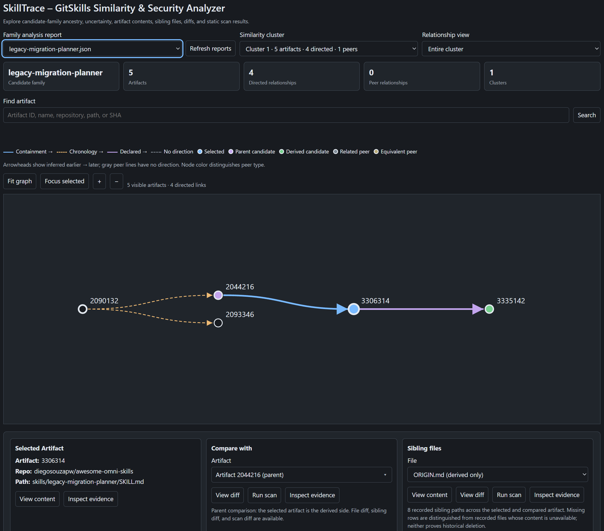
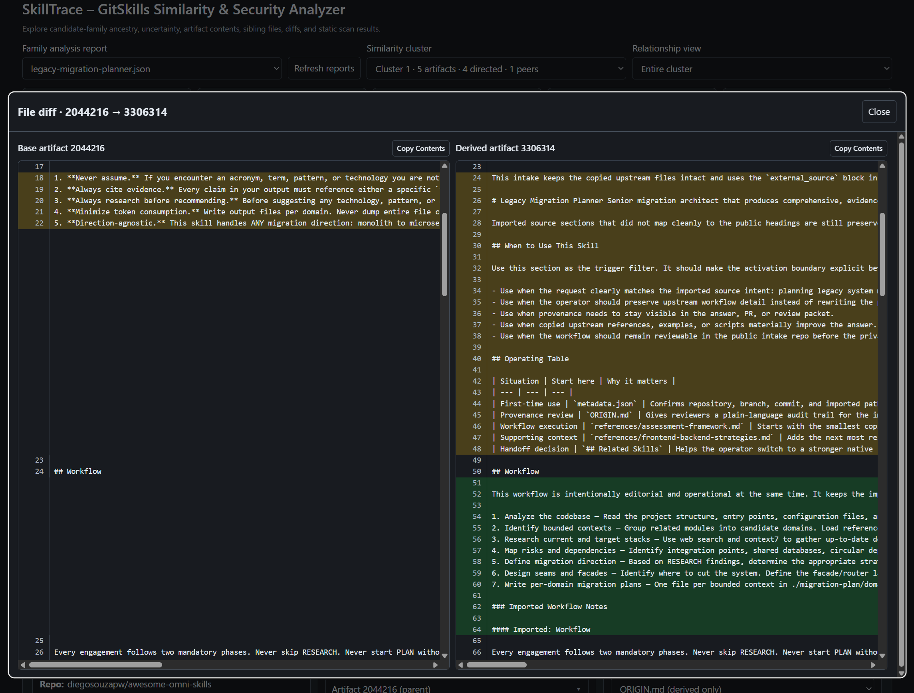
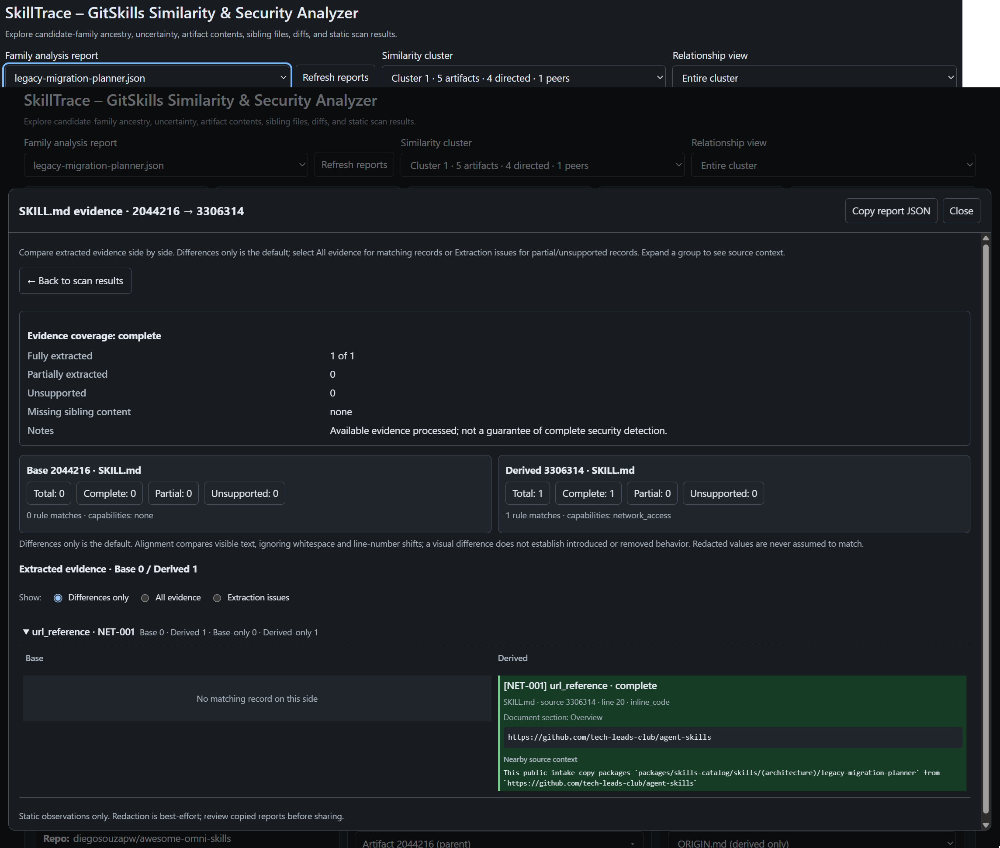

# CSC 580 Group Project - Mining AI-Native Software Engineering

This group project investigates AI-native software engineering using research directions inspired by the [MSR 2027 Mining Challenge](https://2027.msrconf.org/track/msr-2027-mining-challenge). Our team focuses on **skill security and supply-chain risk** in the GitSkills dataset: whether modified or reused skills introduce security-sensitive behavior not present in related artifacts. We use a reproducible pipeline to analyze artifact relationships, detect changes with static security rules, and validate findings through manual review. The project is developed iteratively using Scrum, with tested code, documented methods, reproducible results, and analysis of limitations.

More information is available in our [Research Question](RESEARCH_QUESTION.md) and [Threat Model](THREAT_MODEL.md).

## Team and Roles

- Kyle Cantrell (Scrum Master)
- Christian Heiney (Researcher/Developer)
- Vaisnavii Mohanraj (Researcher/Developer)
- Jim Prantzalos (Product Owner)

## Getting Started

The steps below set up the project source code, Python environment, dependencies, and local DuckDB database. You will need Git, Python 3.12 or newer, and the [DuckDB CLI](https://duckdb.org/docs/installation/). See the [data setup guide](data/README.md) for detailed database instructions.

### 1. Clone the repository

Clone the project and change into the repository directory:

```bash
git clone https://github.com/umdnp/csc580-project8.git
cd csc580-project8
```

### 2. Install `uv`

We recommend [`uv`](https://docs.astral.sh/uv/) for managing Python environments and dependencies. If needed, follow the [official installation instructions](https://docs.astral.sh/uv/getting-started/installation/).

### 3. Create the Python virtual environment

From the repository root:

```bash
uv venv
```

### 4. Install project dependencies

Dependencies are defined in `pyproject.toml`. Install them with:

```bash
uv sync
```

### 5. Download the GitSkills dataset

Download the original **SQLite** database from the [GitSkills dataset on Zenodo](https://zenodo.org/records/21875637). The project imports this database into DuckDB and creates additional tables used for analysis.

### 6. Build the local DuckDB database

From the repository root, run:

```bash
bash bin/create_gitskills_db.sh
```

Then create the analysis tables and artifact groupings:

```bash
duckdb /c/data/duckdb/agent_skills_release.db < sql/create_analysis_tables.sql
duckdb /c/data/duckdb/agent_skills_release.db < sql/update_artifact_groupings.sql
```

These are the default Git Bash paths on Windows. Adjust the script and commands for your system (for example, `/mnt/c/...` in WSL). See the [local database setup instructions](data/README.md#local-duckdb-development-setup) and [Data Dictionary](DATA_DICTIONARY.md) for details.

### 7. Configure the database path

Set `GITSKILLS_DB` to the generated **DuckDB** file before launching the notebook or SkillTrace. For example, in Git Bash with Windows Python:

```bash
export GITSKILLS_DB="C:/data/duckdb/agent_skills_release.db"
```

Use `/mnt/c/data/duckdb/agent_skills_release.db` in WSL, or follow the [Project Guide](docs/instructions/getting_started.md) for other environments.

## End-to-End Research Pipeline

Our primary pipeline is the [`end_to_end_pipeline.ipynb` notebook](notebooks/end_to_end_pipeline/end_to_end_pipeline.ipynb). It identifies relationships between skill artifacts, scans security-sensitive changes in skills and associated files, and generates analysis results and samples for manual validation. You do not need to run the individual family-analysis or scanning tools beforehand.

Open the notebook in a supported IDE using the project's `.venv` Python environment, or launch JupyterLab from the repository root:

```bash
uv run --with jupyterlab jupyter lab
```

In JupyterLab, open `notebooks/end_to_end_pipeline/end_to_end_pipeline.ipynb`, review its configuration, and run the analysis cells in order. The final validation cell is intended for use after manual review and adjudication.

Results are saved under [`notebooks/end_to_end_pipeline/results/`](notebooks/end_to_end_pipeline/results/), including tables, figures, audit records, and manual-review samples. For full execution instructions and output descriptions, see the [Pipeline README](notebooks/end_to_end_pipeline/README.md) and [saved results guide](notebooks/end_to_end_pipeline/results/sprint2/README.md).

## Automated Tests

From the repository root:

```bash
uv run python -m pytest
```

Tests use constructed inputs and temporary databases; the full GitSkills dataset is not required. See the [testing guide](tests/sample_skills/README.md#testing).

## Limitations

Inferred relationships do not establish historical copying or ancestry, and scanner detections are not proof of malicious behavior. Incomplete data and static-analysis limitations can affect findings. See [Threats to Validity](THREATS_TO_VALIDITY.md) and the [design documentation](docs/design/ARCHITECTURE.md). Dataset content is inspected, **not executed**.

## SkillTrace - Visual Inspection and Manual Validation

**SkillTrace** is a browser-based tool we built to support manual inspection of GitSkills artifacts. It visualizes artifact relationships, compares differences between skill files (`SKILL.md`) and sibling resources, and runs scans to display detected changes and supporting evidence alongside visual diffs. We use it to manually validate the pipeline's findings.

<table>
  <tr>
    <td width="33%" align="center">
      <a href="figures/skilltrace/skilltrace_home.png">
        
      </a>
    </td>
    <td width="33%" align="center">
      <a href="figures/skilltrace/skilltrace_diff.png">
        
      </a>
    </td>
    <td width="33%" align="center">
      <a href="figures/skilltrace/skilltrace_scan.png">
        
      </a>
    </td>
  </tr>
</table>

To inspect a family, first generate its report from the repository root:

```bash
uv run python -m gitskills.tools.analyze_family cometchat-core --output apps/skilltrace/reports
```

Then start SkillTrace:

```bash
uv run python -m apps.skilltrace --host 127.0.0.1 --port 8000
```

Open **http://127.0.0.1:8000**, select a family report, and choose artifacts to inspect. Use the diff views and **Run scan** / **Inspect evidence** tools to compare detections against the original content. SkillTrace's on-demand scans inspect a selected skill or sibling file; the notebook performs the broader family-level analysis.

For manual validation, we use the notebook's directed-pair and relationship-pair samples to check inferred relationships and scanner accuracy. Working review records are stored in the [directed-pair annotations](notebooks/end_to_end_pipeline/results/sprint2/manual-review/directed-pairs/annotations.csv) and [relationship-pair annotations](notebooks/end_to_end_pipeline/results/sprint2/manual-review/relationship-pairs/annotations.csv). See the [Manual Annotation Protocol](docs/instructions/manual_annotation_protocol.md) and [SkillTrace README](apps/skilltrace/README.md) for the review process and additional app instructions.
