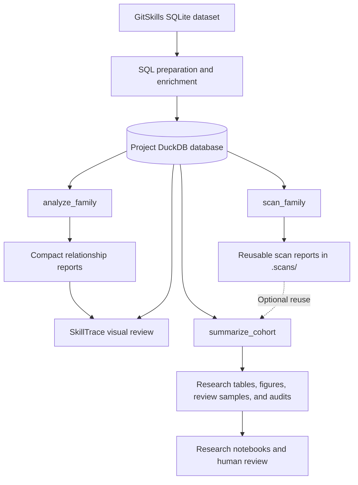
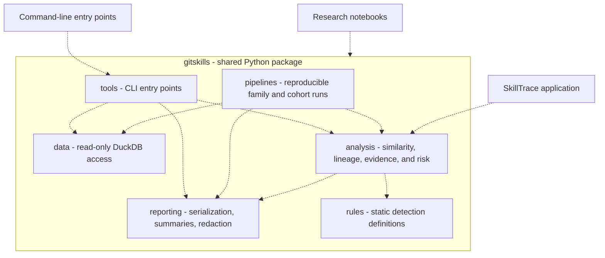
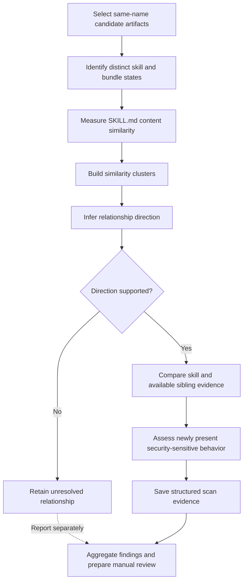

# Solution Architecture

## Purpose

This document describes how the project's data preparation, analysis pipeline, shared Python library, research tools, notebooks, and SkillTrace application work together to address **Research Question 4 (RQ4): Skill security and supply-chain risk**.

The focus is on architectural responsibilities and data flow. The [Design Guide](DESIGN.md) covers implementation details; the [project README](../../README.md) and [Tools Guide](../../TOOLS.md) cover setup and usage.

## Research Challenge

> Do modified or reused skills introduce command execution, file-system access, network access, or other risky behavior that was absent from an earlier version or source artifact?

The **GitSkills dataset** is a downloadable, static SQLite database of discovered agent skills and related repository information. It is not a revision-history database. Although it contains some commit metadata, it generally does not provide complete `SKILL.md` histories or identify which skill was copied from another.

Consequently, artifacts with the same name are only **candidates** for a relationship. The project must first determine which artifacts have similar content, then infer a plausible earlier/base and later/derived ordering from available evidence. Only then can it assess whether security-sensitive behavior is present in one artifact but absent from its inferred predecessor. An inferred relationship is not proof of direct copying or original authorship. See [RDR-001](../decisions/RDR-001-retain-question-4-versioning-strategy.md).

## Solution Overview

The research requires a consistent path from GitSkills artifacts to inferred relationships, security evidence, and validated findings. SQL preparation creates the analytical database. Relationship analysis, security scanning, reporting, and visual review then use that common data foundation.

Each tool can run independently using the shared analysis library. SkillTrace loads saved **compact** relationship reports and retrieves source details from DuckDB. `summarize_cohort` runs the analysis it needs, optionally reuses compatible saved scans, and does not require SkillTrace reports or separately generated scan results.

## Software Package Architecture

The command-line tools, SkillTrace, and research notebooks need consistent relationship and security analysis. Rather than duplicating those capabilities in each consumer, the project packages them in the reusable **`gitskills` Python library**.

Dashed arrows show **conceptual use of shared capabilities**, not every source-code import. The package separates database access, analytical methods, detection rules, reporting, reusable pipelines, and CLI entry points. The end-to-end notebook calls `gitskills.pipelines` directly; it does not invoke command-line processes. SkillTrace consumes saved relationship reports and uses the same analysis library for focused reviews. The [Design Guide](DESIGN.md) describes the internal components and their interactions.

## Data Foundation

The GitSkills tables contain data that can be associated, but do not define the explicit cross-table relationships needed for analysis. To establish a consistent data foundation, SQL preparation imports them into a **DuckDB analysis database** and adds local identifiers and logical links between repositories, discovered `SKILL.md` artifacts, and their bundled sibling resources. These links support analysis; they do not establish skill ancestry.

A derived `artifact_groupings` table organizes qualifying artifacts by **skill name and normalized description**. For relationship discovery, the pipeline uses **all qualifying artifacts sharing a name** as the candidate population, even when their descriptions differ. Name matching narrows the search; it does not establish similarity or ancestry.

An unchanged `SKILL.md` can still be distributed with different bundled resources. Content fingerprints help distinguish those bundles, while incomplete sibling information remains unknown rather than being treated as a match.

These additions make the source data usable for repeatable family analysis without claiming relationships that GitSkills does not supply. See the [Data Dictionary](../../DATA_DICTIONARY.md), [database preparation SQL](../../sql/create_gitskills_duckdb.sql), [analysis-table SQL](../../sql/create_analysis_tables.sql), and [RDR-003](../decisions/RDR-003-grouping-and-sibling-fingerprints.md).

## Research Analysis Pipeline

The pipeline reconstructs potential skill relationships in three stages. First, artifacts sharing a skill name form a **candidate population** for comparison. Content similarity then identifies **similarity clusters**: groups of distinct `SKILL.md` variants linked by qualifying similarity matches, directly or through intermediate variants. Finally, available evidence supports **inferred lineage**: plausible base/derived relationships within those clusters.

Neither shared names nor similarity establishes ancestry. Relationships whose direction cannot be supported remain unresolved rather than being treated as verified revisions.

### Relationship Discovery and Direction

Within each same-name candidate population, token-based similarity measures how much `SKILL.md` content is shared, including containment and overlap. Equivalent content states are identified, while bundled resources are tracked separately so differences outside `SKILL.md` are not lost.

Similarity does not establish which artifact came first. The pipeline therefore infers direction from available source declarations, chronology, repository-creation boundaries, and directional containment. A cluster may have several plausible starting points. Relationships without defensible direction remain unresolved and cannot support claims that behavior was *introduced* or *removed*. See [RDR-004](../decisions/RDR-004-skillmd-similarity-strategy.md) and [RDR-007](../decisions/RDR-007-effective-chronology-and-direction-evidence.md).

### Static Security and Evidence Analysis

Once a base/derived ordering is supported, the analysis must determine whether the derived artifact contains security-sensitive behavior absent from its inferred base. The shared scanner examines stored skill instructions and available sibling-file content for command execution, network activity, file operations, credentials, external code, and system changes.

Detection rules identify candidate behavior. Evidence extraction and normalization make it possible to compare the underlying commands, URLs, paths, and other constructs—not just whether a rule matched or how many matches occurred. Risk assessment then identifies newly present behavior that meets defined, evidence-based indicators and records uncertainty or incomplete coverage separately. The scanner does not simulate execution or resolve runtime values.

The result is **evidence for review**, not a finding of malicious intent. For detection scope and assessment criteria, see the [Threat Model](../../THREAT_MODEL.md), [RDR-008](../decisions/RDR-008-evidence-representation-and-comparison.md), [RDR-009](../decisions/RDR-009-sibling-security-scanning-scope.md), and [RDR-010](../decisions/RDR-010-evidence-based-risk-indicators.md).

### Reporting and Research Outputs

Individual artifact comparisons must be combined to evaluate RQ4 across the selected population. The shared library and its command-line adapters produce **family relationship reports** (`analyze_family`), **family security reports** (`scan_family`), and focused direct comparisons (`scan_diff`). Reports retain inferred direction, supporting evidence, assessment results, and coverage information.

`summarize_cohort` combines family analysis, directed scanning, reporting, and manual-review sampling for the selected families. The end-to-end notebook calls that pipeline directly. Its outputs include reusable scan reports under `results/<run>/.scans/`, review templates under `manual-review/`, research summaries under `review/`, figures, and source-coverage audits. Source consistency is checked before reusing saved scans or applying completed reviews. Relationships with unknown direction and incomplete coverage remain separate from negative scan findings. Human judgments are entered and adjudicated outside the automated pipeline; see the [Manual Annotation Protocol](../instructions/manual_annotation_protocol.md).

These outputs connect the reconstructed relationships to the evidence needed to answer RQ4: **where inferred derived artifacts contain security-sensitive behavior not observed in their base artifacts, and how often the defined indicators occur**.

## SkillTrace: Visual Analysis and Validation

Inferred ancestry can be difficult to validate from tables or JSON alone. A similarity cluster may contain identical copies, several possible predecessors, indirect connections, and relationships whose direction cannot be established. This also makes it difficult to manually verify scan findings against the underlying artifacts.

**SkillTrace addresses these problems through interactive visual analysis.** Researchers can explore inferred relationship graphs, inspect stored `SKILL.md` and sibling content, compare artifacts side by side, and run on-demand security scans. These capabilities help validate inferred relationships, check scanner findings against source text, identify false positives or missed behavior, and refine detection rules.

SkillTrace displays saved `analyze_family` reports and retrieves source content from DuckDB. Its on-demand scans reuse the **same shared analysis library** as the command-line tools rather than implementing a separate scanner. They are focused comparisons, not substitutes for complete family-level assessments, particularly when sibling evidence spans files.

SkillTrace aids validation and interpretation; its graphs do not prove historical lineage. See the [SkillTrace Guide](../../apps/skilltrace/README.md).

## Reuse, Runtime, and Trust Boundaries

The solution runs as a **local Python-based research system** built from the prepared DuckDB database, installable `gitskills` package, command-line tools, research notebooks, saved reports, and SkillTrace's FastAPI/browser interface. Sharing the analytical library avoids divergent rule sets or inference logic across these consumers.

The data and reports are research inputs and outputs; they are not executed as agent instructions. Scanning is static: it does not run untrusted scripts, clone repositories, or retrieve external code. Findings are reproducible only in the context of the dataset selection, similarity and direction policies, scanner definitions, and available content. Missing history, incomplete sibling data, and uncertain ordering limit what can be concluded.

For environment and execution requirements, see the [project README](../../README.md). For interpretation and safety limitations, see [Threats to Validity](../../THREATS_TO_VALIDITY.md).

## Related Documents

- [Design Guide](DESIGN.md) — classes, component structure, and representative interactions.
- [Research Question](../../RESEARCH_QUESTION.md) — study scope, variables, and outcome measures.
- [Data Dictionary](../../DATA_DICTIONARY.md) — source schema and project-derived relationships.
- [Research Decision Records](../decisions/README.md) — rationale behind the analysis methods.
- [Tools Guide](../../TOOLS.md) and [SkillTrace Guide](../../apps/skilltrace/README.md) — detailed behavior and usage.
