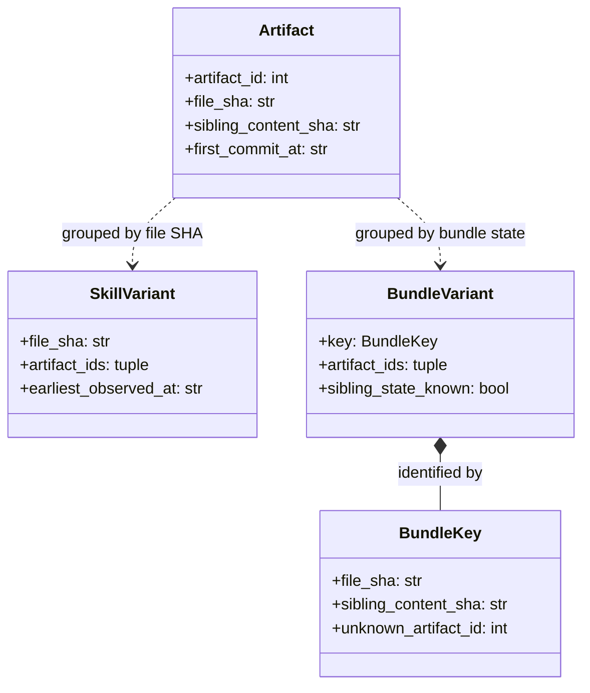
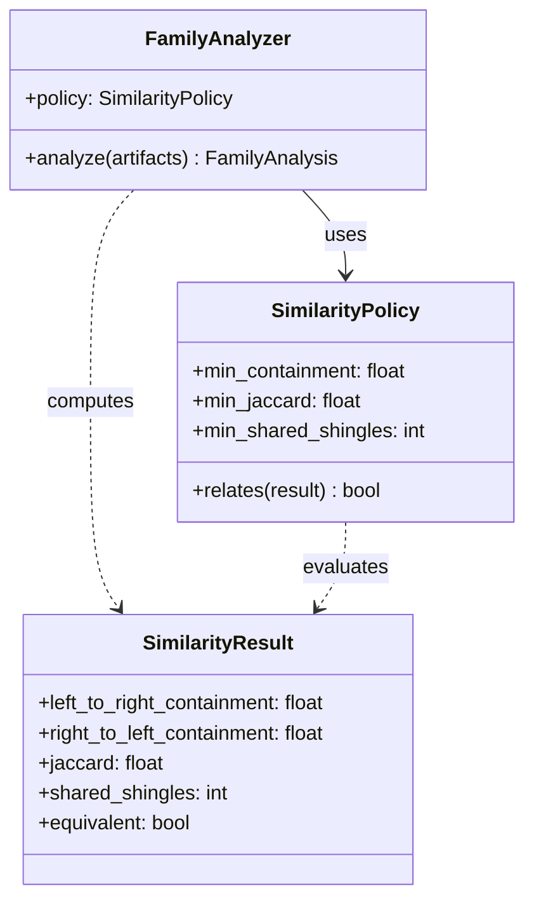
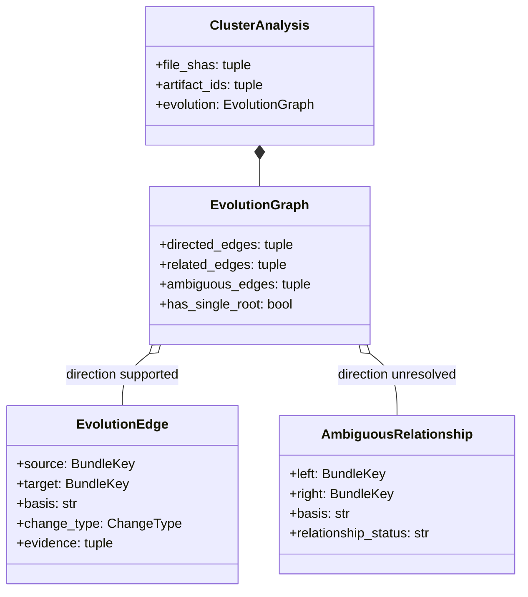
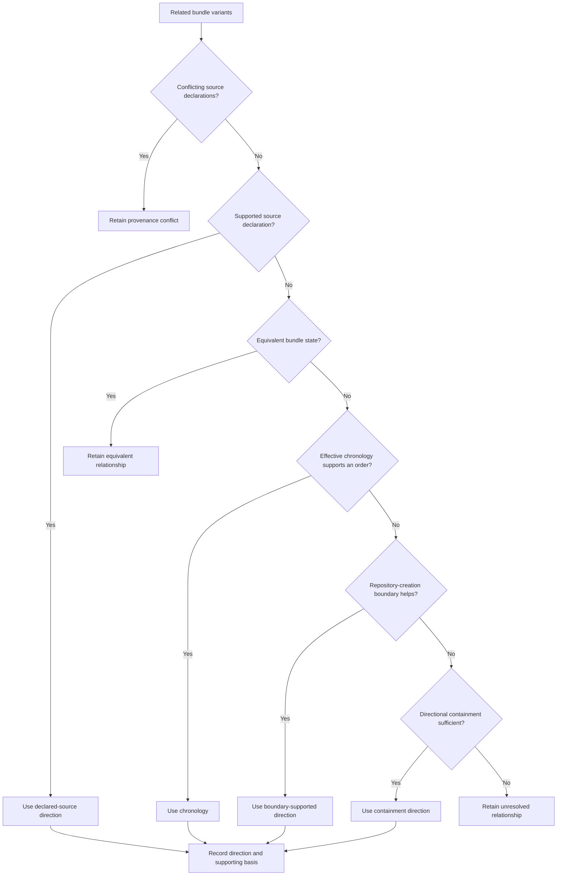
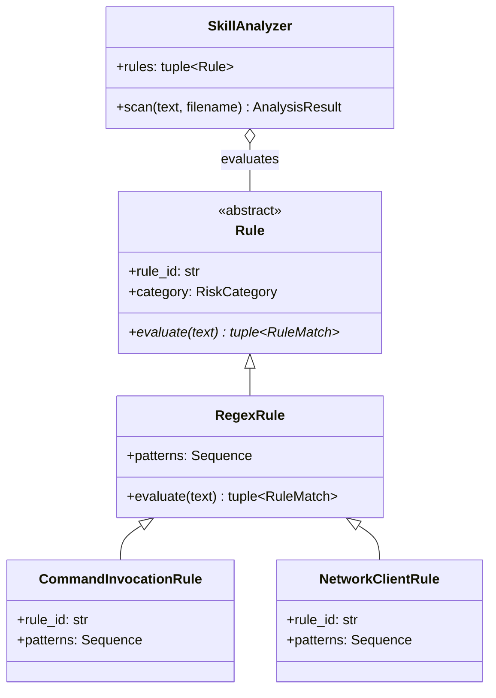
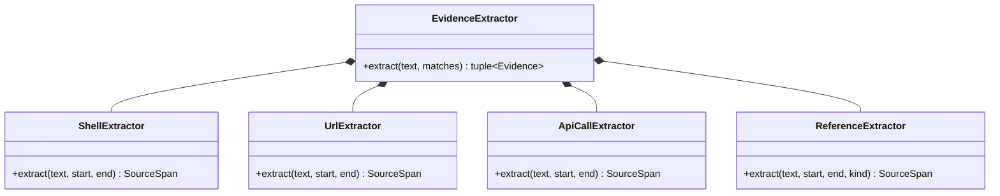
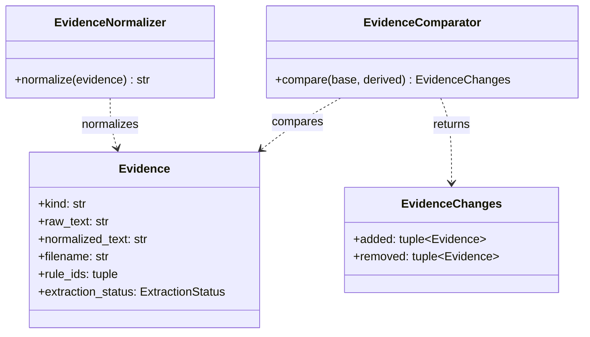
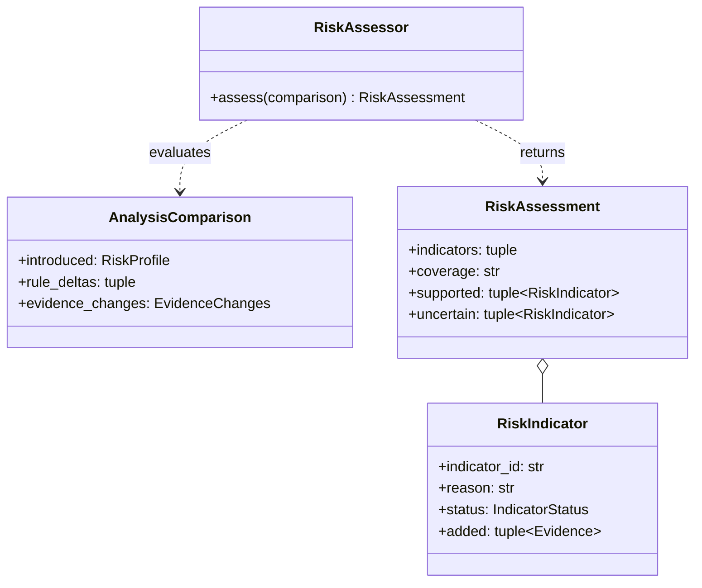
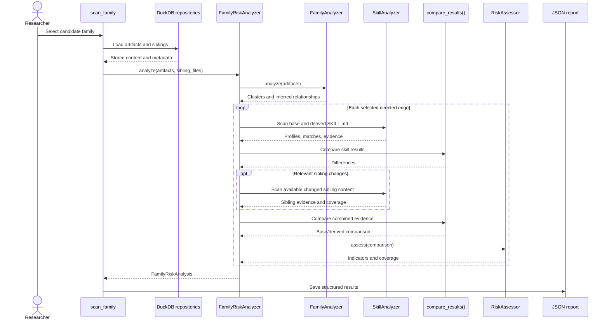
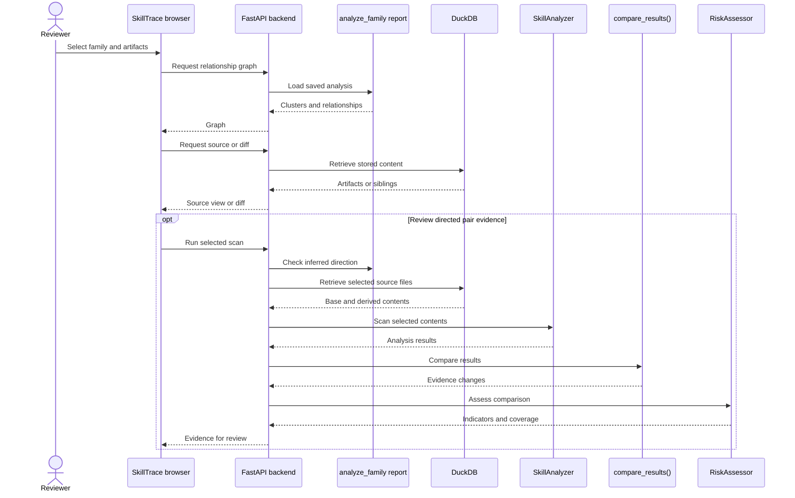

# Solution Design

## Purpose

This guide describes how the `gitskills` library and its consumers implement the analysis for Research Question 4 (RQ4). It covers the principal data models, object-oriented relationships, and interactions behind similarity analysis, inferred lineage, static scanning, evidence comparison, risk assessment, and manual validation.

The [Solution Architecture](ARCHITECTURE.md) describes the overall research system and data flow. The [project README](../../README.md) and [Tools Guide](../../TOOLS.md) cover setup, commands, and outputs.

## Component Organization

GitSkills does not supply reliable revision histories or copying relationships between skill artifacts. The analysis must infer plausible relationships and then apply consistent security comparisons. The installable `gitskills` package separates these responsibilities so the command-line tools, notebooks, and SkillTrace can reuse the same behavior.

| Component | Principal implementation | Responsibility |
| --- | --- | --- |
| Data access | `gitskills.data` | Load candidate artifacts and recorded sibling files from DuckDB |
| Family analysis | `gitskills.analysis.family`, `family_models`, `similarity`, `provenance` | Model content variants, identify similarity clusters, and infer relationships |
| Static detection | `gitskills.rules`, `analysis.analyzer` | Evaluate detection rules and collect source matches |
| Evidence analysis | `analysis.evidence_*`, `comparator` | Extract, normalize, and compare source constructs |
| Risk assessment | `analysis.risk_assessor`, `risk_models` | Evaluate evidence changes against review indicators |
| Family security analysis | `analysis.family_risk` | Coordinate directed comparisons, including sibling files |
| Report generation | `gitskills.reporting`, `analysis.family_reporting` | Build consistent JSON reports, research summaries, and redacted excerpts |
| End-to-end orchestration | `gitskills.pipelines.family`, `cohort`, `provenance` | Run selected families, check report identity, and record cohort audits |
| CLI and visual review | `gitskills.tools`, `apps/skilltrace` | Expose shared analysis methods and support manual inspection |

## Family Relationship Design

### Artifacts, Skill Variants, and Bundle Variants

Two records can contain the same `SKILL.md` text without representing the same bundled skill. Conversely, the same stored skill may occur in several repositories. The family model distinguishes the **artifact occurrence**, the **skill-content variant**, and the **bundle variant** so that these cases are not collapsed into one identity.

`SkillVariant` groups occurrences of the same stored skill content. `BundleVariant` also accounts for the sibling-content fingerprint. When sibling state is unknown, `BundleKey` retains an artifact-specific identity rather than assuming two bundles are equivalent. See [RDR-003](../decisions/RDR-003-grouping-and-sibling-fingerprints.md).

### Similarity and Relationship Models

Matching names provide candidate artifacts, but not evidence of copying. `FamilyAnalyzer` compares distinct skill variants using token-shingle similarity. `SimilarityPolicy` keeps the criteria for qualifying relationships separate from the analysis procedure, allowing the criteria to be evaluated and adjusted without changing the family model.

Qualifying links connect skill variants into **similarity clusters**, including indirectly connected variants. These clusters identify plausible relationships; they do not establish ancestry. See [RDR-004](../decisions/RDR-004-skillmd-similarity-strategy.md).

Each cluster contains an evolution graph that distinguishes relationships with supported direction from relationships that remain equivalent, conflicting, or unresolved.

An `EvolutionEdge` records an inferred **base → derived** relationship and its supporting basis, not a recovered Git commit or verified copy. `AmbiguousRelationship` preserves relevant comparisons without assigning direction. The graph also distinguishes selected primary predecessor edges from other direction-supported related edges.

### Inferring Direction

Content similarity can establish relatedness without establishing which artifact preceded another. The analyzer evaluates available evidence before assigning a base/derived ordering.

Conflicting source declarations remain ambiguous. Equivalent bundle states are also retained without direction unless a supported source declaration establishes one. Effective chronology can draw on an equivalent peer only when its known bundle state supports that equivalence. Repository creation dates provide boundaries, not actual skill-creation dates. See [RDR-005](../decisions/RDR-005-evolution-and-provenance.md) and [RDR-007](../decisions/RDR-007-effective-chronology-and-direction-evidence.md).

## Static Detection and Evidence Design

### Rule Abstraction and Polymorphism

Different security constructs require different detection patterns, but the scanner should evaluate them uniformly. The abstract `Rule` defines the evaluation contract. `RegexRule` supplies the shared matching algorithm, while concrete rule classes define their identifiers, categories, descriptions, and patterns.

`SkillAnalyzer` calls `evaluate()` through the common `Rule` interface. Concrete regex rules inherit the implementation rather than overriding it; their patterns determine what they detect. Other rule subclasses follow the same structure for file operations, credentials, external code, and system changes. This allows rules to be added or replaced without modifying the scanner's evaluation loop. See [`rules/base.py`](../../src/gitskills/rules/base.py) and [`rules/registry.py`](../../src/gitskills/rules/registry.py).

The scanner evaluates all configured rules and returns a capability profile and located `RuleMatch` records. For `SKILL.md`, frontmatter is masked by default without shifting source positions. Detection alone does not establish that a construct is executable or risky. See [RDR-002](../decisions/RDR-002-language-and-frontmatter-scanning.md).

### Evidence Extraction by Composition

A rule match may identify only one word or part of a larger command. Evidence analysis needs the containing source construct, its context, and a comparison form. `EvidenceExtractor` coordinates specialized extractors through **composition**, rather than requiring each extractor to inherit a common implementation.

| Extractor | Source construct recovered |
| --- | --- |
| `ShellExtractor` | Commands, arguments, and pipelines around a match |
| `UrlExtractor` | URLs and Markdown links |
| `ApiCallExtractor` | Function or API calls, including arguments where recoverable |
| `ReferenceExtractor` | Standalone references such as credential names and paths |

The coordinating extractor associates matches with source constructs and preserves their location and context. `extraction_status` reflects source recovery, not runtime interpretation: fully captured dynamic commands are `complete`, while incomplete or unsupported evidence remains explicit. The extractors do not execute stored text. See [RDR-008](../decisions/RDR-008-evidence-representation-and-comparison.md).

### Evidence Normalization and Comparison

A change in formatting or surrounding prose should not necessarily count as a change in security-sensitive behavior. `EvidenceNormalizer` produces a conservative comparison form while retaining the original text. `EvidenceComparator` compares evidence occurrences by filename, construct kind, and normalized content.

The normalization preserves meaningful command arguments, paths, and URL details. The comparison accounts for repeated occurrences, reports added and removed evidence, and does not assume that one removed construct was modified into a particular added construct.

The `compare_results(base, derived)` function combines these evidence changes with capability differences and per-rule match-count deltas in an `AnalysisComparison`. This keeps matching and source-level comparison distinct. See [RDR-008](../decisions/RDR-008-evidence-representation-and-comparison.md).

### Evidence-Based Risk Assessment

Newly observed evidence is not automatically a security concern. `RiskAssessor` interprets a directional comparison using defined review indicators and source context, keeping security interpretation separate from detection and comparison.

Supported indicators identify evidence that warrants review; uncertain indicators and coverage fields preserve limitations in what could be assessed. Several indicators can point to one construct, so the number of indicators is not the same as the number of distinct findings. No indicators does not establish safety. See [RDR-010](../decisions/RDR-010-evidence-based-risk-indicators.md).

## Family Security Analysis

An inferred family may contain several related bundle variants, but only direction-supported pairs can support a claim that behavior is newly present in a derived artifact. `FamilyRiskAnalyzer` coordinates relationship analysis, scanning, evidence comparison, and risk assessment. It also accounts for available bundled sibling files.

`FamilyRiskAnalyzer` composes `FamilyAnalyzer` and `SkillAnalyzer` and uses `RiskAssessor`; it caches repeated content scans where possible. It can analyze selected **primary** predecessor edges or include other direction-supported edges. Relationships without defensible direction are not treated as negative security comparisons.

`PairObservation` records every assessed directed pair, including those without indicators. `FlaggedPair` retains detailed changed evidence or findings; `IncompletePair` preserves sibling-coverage problems. Missing sibling text and incomplete listings remain unknown, rather than being interpreted as unchanged content. See [RDR-009](../decisions/RDR-009-sibling-security-scanning-scope.md).

Family summaries distinguish `pairs_incomplete` (missing sibling coverage) from `pairs_evidence_coverage_incomplete` (including partial or unsupported extraction). Pair observations include `coverage.issues`, even when unflagged. `flag_reasons` explains why a pair was flagged, which does not necessarily mean a new capability; `network_role` distinguishes URL references from network operations.

## Research Reporting and Validation

`gitskills.pipelines.cohort.summarize_cohort()` coordinates family analysis, security scanning, research summaries, and manual-review sampling for one or more selected families. It uses the shared analyzer and scanner implementations; it does not depend on earlier CLI runs or SkillTrace reports. `gitskills.reporting.cohort_summary` builds the research tables, figures, and validation outputs.

Family reports produced by `analyze_family` retain the clusters, inferred relationships, and evidence needed by SkillTrace. Exhaustive pairwise similarity measurements and supplementary diagnostics appear only with `--verbose`. During cohort summarization, similarity comparisons needed for relationship sampling are calculated in memory and are not saved as verbose JSON.

Compatible family scan reports can be reused from `results/.scans/`; separate cache bookkeeping is stored under `.scans/.metadata/scan-manifest.json`. `--rescan` forces scanning again. Other outputs include source and execution manifests, coverage audits, research summaries, and manual-review samples under `manual-review/`. Sampling does not change the full analyzed population or indicator-frequency denominators.

After independent annotation and adjudication, a compatible saved cohort can incorporate the completed judgments without repeating similarity analysis or security scanning. The pipeline verifies the saved samples and settings before updating review metrics and protects completed work from silent replacement. See the [Manual Annotation Protocol](../instructions/manual_annotation_protocol.md) and [Tools Guide](../../TOOLS.md).

## SkillTrace Design

Inferred lineage can be difficult to inspect in tables or JSON, and detected evidence must be checked against its source. SkillTrace supports this validation through relationship graphs, stored content inspection, line-level diffs, and focused on-demand scans.

The FastAPI backend reads saved `analyze_family` reports for graph structure, retrieves artifact content from DuckDB, and calls the shared `gitskills` analysis library. SkillTrace does not maintain a separate implementation of the rules or lineage inference.

Single-file **Inspect evidence** actions expose detected constructs without requiring a pair. Pairwise **Run scan** actions compare a direction-supported `SKILL.md` pair or an individual matching sibling path. They are narrower than `scan_family`, which can assess combined skill and sibling evidence, including cross-file relationships. See the [SkillTrace Guide](../../apps/skilltrace/README.md).

## Extension and Validation Boundaries

The principal design boundaries keep change localized. New static detections can be implemented through the rule interface; source-construct extraction and normalization remain separate from detection; review indicators can evolve without changing similarity analysis; and relationship inference can change without requiring each consumer to implement it independently.

Tests under `tests/pytests/` exercise the detection, similarity, chronology, evidence, risk, sibling, reporting, and application behavior. Manual inspection through SkillTrace and validation samples addresses the separate question of whether inferred relationships and security interpretations are supported by the stored artifacts. See the [Threat Model](../../THREAT_MODEL.md) and [Threats to Validity](../../THREATS_TO_VALIDITY.md).

## Related Documents

- [Solution Architecture](ARCHITECTURE.md) — major components and research workflow.
- [Research Question](../../RESEARCH_QUESTION.md) — study scope and outcome measures.
- [Data Dictionary](../../DATA_DICTIONARY.md) and [database preparation SQL](../../sql/create_gitskills_duckdb.sql) — source and derived data structures.
- [Research Decision Records](../decisions/README.md) — reasoning behind the analysis policies.
- [Tools Guide](../../TOOLS.md) and [SkillTrace Guide](../../apps/skilltrace/README.md) — execution, reports, and interactive review.
