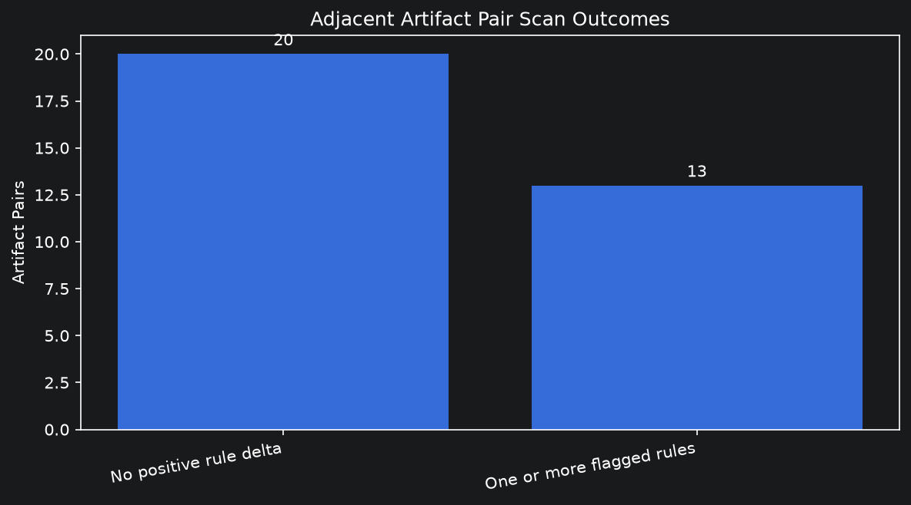
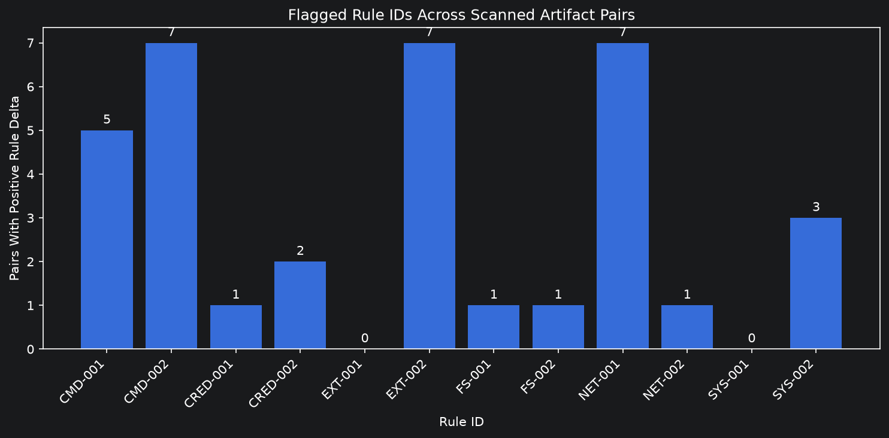
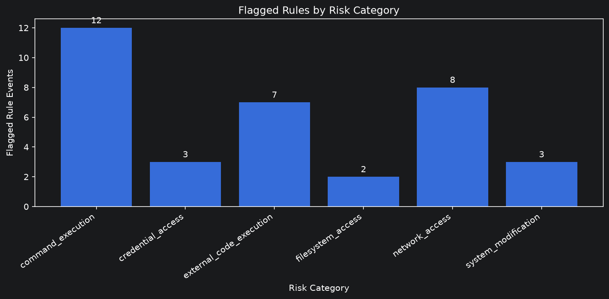

\clearpage

# Results

This section distinguishes completed Sprint 1 exploratory outputs from the Sprint 2 analysis and manual validation that remain to be completed. The Sprint 1 notebook outputs and worked family example demonstrate selected tool behavior; neither estimates population prevalence or validates historical ancestry.

## Sprint 2 Evidence Status

At this report revision, the Sprint 2 population-analysis and report-ready table/figure work has not produced committed result artifacts. GitHub Stories [7.1](https://github.com/umdnp/csc580-project8/issues/101) and [7.2](https://github.com/umdnp/csc580-project8/issues/102) remain open, and there is no repository-root `results/` directory containing their outputs. Accordingly, the artifact/exclusion totals, category counts, comparison totals, and security-change rates for the approved Sprint 2 analysis are **not reported** here. Sprint 1 results below are retained as historical exploratory evidence and are not relabeled as Sprint 2 results.

Sprint 2 has produced a review design, not review outcomes: the manual-validation CSV contains 13 selected cases (5 positive, 4 negative, 4 ambiguous) and 20 distinct artifact occurrences. The reviewer and adjudication fields remain blank. Those counts describe sample construction only; they are not counts of validated true/false positives or negatives.

## Dataset Processing Results

The local candidate-selection audit on October 15, 2026 retained 943,257 of 3,797,117 source artifact occurrences, a reduction of 75.16 percent. The retained rows represent 162,995 exact-name families and 628,026 name-and-normalized-description groups. Dataset and Data Preparation provides the executable SQL, cumulative counts, and filter rationale. These totals describe candidate construction, not completed similarity analyses, directed comparisons, or security scans. Unique analyzed SHA counts, final relationship totals, scan completion and exclusion counts remain to be measured by the broader pipeline.

### Saved Sprint 1 Extraction Outcomes

Inspection of `notebooks/extraction_pipeline/results/sample_artifacts_scanner_results.parquet` confirmed the following saved results. This is an audit of the saved output, not a rerun of every dataset comparison with the current rules.

| Saved notebook measure | Observed value |
| --- | ---: |
| Artifact rows | 43 |
| Exact-name groups | 10 |
| Adjacent comparisons with stored scanner output | 33 |
| Comparisons with at least one positive rule-count delta | 13 (39.4%) |
| Positive rule-delta events across those comparisons | 35 |
| Sum of positive rule-count deltas | 77 |

The 77 additional matches sum positive deltas only; they are not the net change after accounting for decreases, a count of unique actions, or a count of newly introduced capabilities. Multiple rules can increase in one pair, and multiple matches can contribute to one rule's delta.

The 33 notebook pairs follow view-order adjacency within names, whereas the saved family-analysis reports contain 17 selected directed relationships. These outputs test different parts of the workflow and must not be combined into one relationship denominator. The 39.4 percent figure describes this purposeful notebook sample only, not population prevalence or a rate of proven harmful changes.

## Security-Pattern Results

The saved Sprint 1 notebook output records positive rule-count deltas in 13 of 33 adjacent artifact comparisons. Across those pairs it records 35 rule-level positive-delta events, summing to 77 additional rule matches. These are increases in matched text, not 35 unique behaviors or 35 newly introduced capabilities. The following category and rule counts come from the saved Parquet output and its then-current 12-rule catalog; they are not Sprint 2 measurements or population prevalence and should not be compared directly with runs using the current 13-rule catalog.

| Category | Positive rule-delta events |
| --- | ---: |
| Command execution | 12 |
| Credential access | 3 |
| External code execution | 7 |
| File-system access | 2 |
| Network access | 8 |
| System modification | 3 |
| **Total** | **35** |

| Rule | Positive-delta events |
| --- | ---: |
| CMD-001 | 5 |
| CMD-002 | 7 |
| CRED-001 | 1 |
| CRED-002 | 2 |
| EXT-001 | 0 |
| EXT-002 | 7 |
| FS-001 | 1 |
| FS-002 | 1 |
| NET-001 | 7 |
| NET-002 | 1 |
| SYS-001 | 0 |
| SYS-002 | 3 |

The original generated figures are reproduced below without altering their data. Each is based on the 33 view-order adjacent comparisons in the saved Sprint 1 Parquet output.







## Introduced Risk Signals

The 13 positive-delta notebook pairs cannot be counted as 13 introductions. The notebook output summarizes changes in match counts; a rule can increase when it already matched the base, and the adjacent ordering comes from the sample view rather than the family method's direction evidence. A population-level introduction count and denominator require the completed Sprint 2 comparison output. No such summary is available in the repository at this report revision.

## Removed and Retained Signals

The saved notebook figure summarizes positive count deltas, not removed or retained rule sets. The worked family example below reports its own endpoint profiles and illustrates that counts can increase in already-present rules without introducing a category. Aggregate Sprint 2 removed, retained, or unchanged counts remain unavailable.

## Results by Relationship Type

The Sprint 1 extraction notebook's 33 adjacent pairs and the family-analysis reports' 17 selected directed relationships are different units produced by different workflows. The first uses view-order adjacency within each skill-name group; the second applies family similarity and direction logic. They are not combined or treated as interchangeable denominators. A Sprint 2 breakdown by relationship type awaits the generated output from Story 7.1.

## Validation Results

The 35 passing pytest cases exercise deterministic scanner, extraction, Parquet, and report-generation behavior, not independent ground truth from dataset artifacts. The 13-case validation sample and annotation protocol are now stored in the repository, but the sample has not yet been manually reviewed; numerical manual-validation results therefore remain unavailable. The worked example below was reproduced from local data, but neither its inferred direction nor its scanner findings have been established here as independently annotated ground truth.

## Representative Examples

### Worked Example: Similarity, Inferred Direction, and Scanner Change

The example uses one five-artifact candidate family from the prepared local DuckDB database. Family and endpoint identities are omitted under the report's reporting policy; the selected source and target are labeled A and B. The analysis was rerun locally on October 15, 2026 at code revision `f2b4c7d`, using the default similarity policy and current registered scanner rules. The database release identifier and integrity hash have not yet been documented, so this is a local demonstration rather than a fully frozen dataset experiment.

#### From Candidate Family to Selected Pair

The family contains five skill variants and five bundle variants in one similarity cluster. All ten distinct skill-variant pairs pass the relatedness policy, but the resulting graph selects only two directed predecessor edges. It also records one equivalent undirected relationship and two direction-unknown relationships; other supported directed candidates are retained as additional relationships.

For the selected A-to-B edge, the analysis reports 2,936 shared shingles, containment of approximately 0.962, and Jaccard of approximately 0.414. Thus, about 96.2 percent of A's distinct shingles occur in B, while their shared shingles account for about 41.4 percent of the combined set. These are representation-overlap measures, not percentages of lines copied or probabilities of common ancestry.

The selected edge has `containment` as its direction basis and is classified as `skill-only`. This supplies a structural hypothesis for treating A as base and B as derived; it does not establish that A was published first or directly copied. The second selected edge in the family uses chronology, illustrating that one family can contain relationships with different evidential bases.

```text
Five exact-name artifact occurrences
          |
Five skill variants; ten qualifying similarity pairs
          |
One cluster; two selected directed predecessor edges
          |
Selected pair A -> B (containment-based, skill-only)
          |
Scan both skill bodies with the same 13-rule catalog
          |
25 base matches -> 49 derived matches; no new categories
```

#### Paired Scanner Results

| Changed rule | Base A | Derived B | Delta |
| --- | ---: | ---: | ---: |
| CMD-001: shell-language code fences | 3 | 5 | +2 |
| CMD-002: command invocations | 2 | 6 | +4 |
| CRED-001: secret-related terms | 11 | 14 | +3 |
| CRED-002: credential-file references | 5 | 12 | +7 |
| EXT-002: package installation | 1 | 3 | +2 |
| FS-003: file-reading commands/APIs | 1 | 2 | +1 |
| NET-001: HTTP/HTTPS URLs | 2 | 7 | +5 |
| **Total rule matches** | **25** | **49** | **+24** |

Each changed rule already matches the base, so none of these increases constitutes new rule presence. All introduced-category flags are false. This example therefore demonstrates increased matches within existing capabilities rather than the introduction of a previously absent category. It cannot support a claim that the derived artifact is more harmful, that instructions executed, or that any credential was exposed.

These counts describe the current code revision and local inputs. Counts depend on the rule catalog, input handling, and analyzed text. Runs using different definitions or processing settings must be labeled separately rather than pooled as measurements from an identical instrument.

#### Scan Scope and Review Implications

This table compares the two skill bodies using `SkillAnalyzer` and `compare_results`, the same scanning and comparison components used by `scan_diff`. It does not present sibling findings. The broader `scan_family` path reviews selected directed edges and applicable sibling changes, and can flag matches in new destination content even without a positive aggregate count delta.

A reviewer should inspect the matched instructions in context, assess the direction evidence separately, and distinguish missing sibling evidence from a negative result. This case shows that the pipeline can connect candidate selection, inferred direction, and rule-level differences; it supplies neither population-level generalization nor independent ground truth.

## Results Summary

The reproduced family example contains five artifacts, ten qualifying similarity pairs, and two selected directed relationships. Its selected containment-based pair has 25 base matches and 49 derived matches, with increases in seven rules and no introduced categories. Seven configured sample-skill tests pass. These observations demonstrate selected implementation behavior; population introduction rates and independently measured validation accuracy remain unreported.